

# Switchless Multi-Speeder Project

**One board, eight DOS versions, no switch: the Switchless 8x Multi-Floppy-Speeder V3 for the Commodore 1541, 1541-II, 1571 and C128DCR – with DolphinDos26 and SpeedDos26, and with kernals that speak parallel, JiffyDOS, burst and serial at the same time.**

**Language:** [English](#english) · [Deutsch](#deutsch)

This is the entry page of the project. Each part has its own repository with manuals, ROM files and build data:

| Repository | Content / Inhalt |
|---|---|
| [**Switchless-Multi-Speeder-Commodore-1541**](https://github.com/FraEgg/Switchless-Multi-Speeder-Commodore-1541) | Hardware: Multi-Speeder V3 for the 1541 and 1541-II / für 1541 und 1541-II |
| [**Switchless-Multi-Speeder-Commodore-1571**](https://github.com/FraEgg/Switchless-Multi-Speeder-Commodore-1571) | Hardware: Multi-Speeder V3 for the external 1571 / für die externe 1571 |
| [**Switchless-Multi-Speeder-Commodore-C128DCR-1571**](https://github.com/FraEgg/Switchless-Multi-Speeder-Commodore-C128DCR-1571) | Hardware: Multi-Speeder V3 for the C128DCR (internal 1571) with kernal switcher / für den C128DCR (internes Laufwerk 1571) mit Kernal-Switcher |
| [**DolphinDOS**](https://github.com/FraEgg/DolphinDOS) | Firmware: DolphinDos26 – drive ROMs, C64, C128 and VIC-20 kernals, MS-Tools, all manuals / Laufwerks-ROMs, C64-, C128- und VIC-20-Kernals, MS-Tools, alle Handbücher |
| [**SpeedDOS**](https://github.com/FraEgg/SpeedDOS) | Firmware: SpeedDos26 – drive ROMs for 1541 and 1571, C64, C128 and VIC-20 kernals, manual / Laufwerks-ROMs für 1541 und 1571, C64-, C128- und VIC-20-Kernals, Handbuch |
| [**Parallel port adapter**](https://github.com/FraEgg/commodore-1541-parallel-port-adapter-c64-c128-speeddos-dolphindos) | Accessory: parallel cable for 1541, 1541-II and 1571 to the user port / Zubehör: Parallelkabel für 1541, 1541-II und 1571 zum Userport |

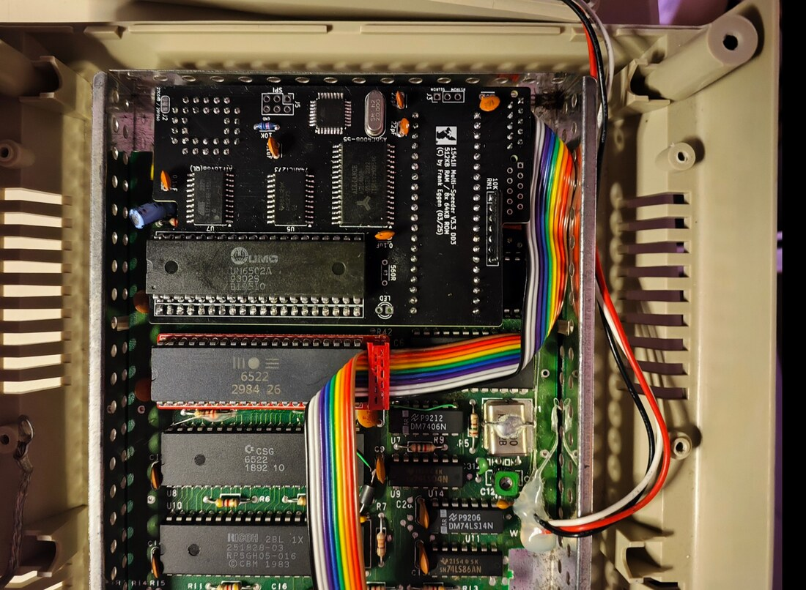

---

# English

## Old drives, new possibilities

A Commodore disk drive from the 1980s and a memory card reader from today on the same computer, both at full speed, without changing a ROM in between: that is what the Multi-Speeder project is about.

The **Switchless 8x Multi-Floppy-Speeder V3** is a small board for the CPU socket of the drive. It turns a 1541, 1541-II, 1571 or the drive of a C128DCR into a drive that holds **eight DOS versions at once** and switches between them **by command** – no switch, no hole in the case, fully reversible. The firmware **DolphinDos26** and **SpeedDos26** brings the two best-known parallel speeders of the 1980s into the present, and the matching kernals make the computer pick the fastest transfer method for every device on the bus by itself.

## Highlights

- **Eight DOS banks, switched by command.** `@I:8@RNROM` and the drive restarts with another DOS; the LED flashes the bank number. Original Commodore DOS, DolphinDOS, SpeedDos26 and DolphinDos26 sit side by side in one 512 KB flash EPROM.
- **512 KB RAM in the drive.** DolphinDos26 reads a whole disk into the drive memory and writes it to any number of target disks – without the computer moving a single byte. The same memory serves as a RAM disk and as a track cache.
- **A true 8-bit parallel port.** A PIA 6821 on the board connects the drive to the user port. Loading 30 KB takes seconds instead of more than a minute and a half over the serial bus.
- **For three families of drives.** One concept for the 1541 and 1541-II, the external 1571 and the 1571 built into the C128DCR, including double-sided disks and the 2 MHz mode of the 1571.
- **Completely documented.** Illustrated manuals in English and German, schematics, Gerber files, bills of materials and ready-made EPROM templates.

## One kernal, every protocol

The heart of the project is the kernals for the C64 and the C128. They no longer know just one transfer method. On **every access** they ask the addressed device what it can do, and then take the fastest way:

| The device on the bus | The kernal uses | Shown while loading |
|---|---|---|
| Drive with DolphinDos26 or DolphinDOS and parallel cable | DolphinDOS parallel | `LOADING DD:` |
| Drive with SpeedDos26 or SpeedDOS and parallel cable | SpeedDOS parallel | `LOADING SD:` |
| Any device with **JiffyDOS**: SD2IEC, drives with a JiffyDOS ROM, Pi1541 | **JiffyDOS** | `LOADING JD:` |
| 1571 or 1581 on a C128 | Commodore burst mode | `LOADING BU:` (SpeedDos26) |
| Everything else | standard serial | – |

This is what makes mixed setups so pleasant. A typical desk today:

- **Device 8:** a real 1541 with Multi-Speeder and parallel cable – loads in parallel.
- **Device 9:** an **SD2IEC** with the whole software collection on an SD card – loads with JiffyDOS, and the function keys change directories and disk images and load straight from the directory.
- **Device 10:** an unmodified drive of a friend – works serially as it always did.

All three run on the same kernal, at the same time, each at its best speed. No kernal switch, no compromise. The kernals have also been tested with **S-JiffyDOS 1541**.

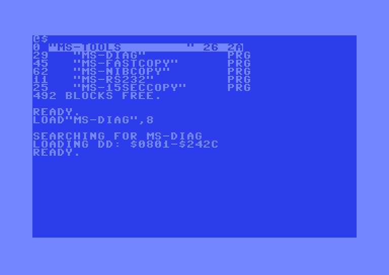
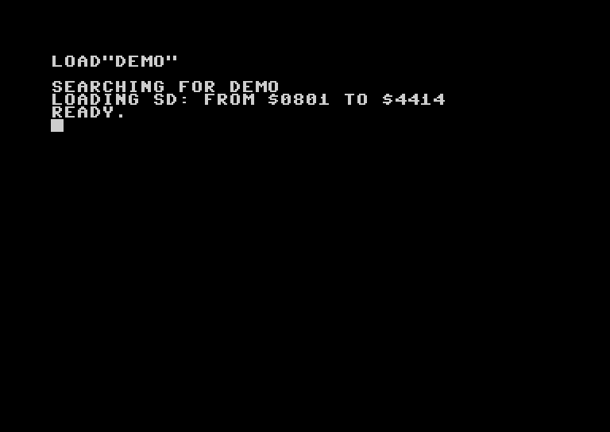

<em>The same computer, three devices, three protocols: DolphinDOS parallel, SpeedDOS parallel and JiffyDOS – chosen automatically.</em>

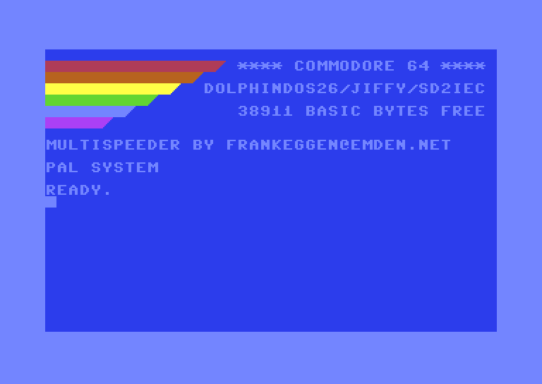
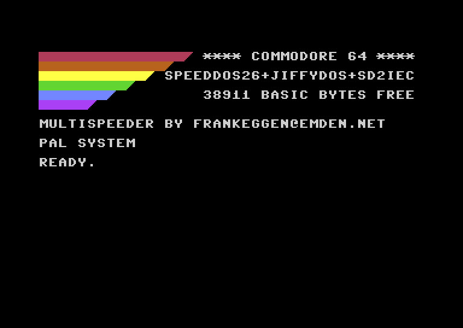

## Retro hardware meets new hardware

The project deliberately builds bridges between the original machines and the hardware of today:

- **SD2IEC.** JiffyDOS in the kernal and dedicated function keys make the card reader a full partner of the real drive. Copy from disk to SD card and back with the MS-Tools.
- **FPGA-based machines such as the Commodore 64 Ultimate.** **DolphinDos26UL** is a firmware made for the drive of the Ultimate: it uses the parallel cable that the machine provides internally. Load the DolphinDos26 kernal and the drive ROM in the menu, and the Ultimate loads in parallel – without any soldering.
- **Pi1541 and JiffyDOS drives.** Devices that run a JiffyDOS drive ROM are served with JiffyDOS automatically; a separate JiffyDOS manual explains commands, function keys and setup.
- **C128 and C128DCR.** The C128 kernals bring everything to C128 mode. In the C128DCR, a kernal switcher changes the kernal together with the DOS bank of the drive: one command, and computer and drive speak the same language.
- **G64 disk images.** MS-NIBCOPY (beta) reads disks bit by bit and exchanges them as G64 files with emulators, the SD2IEC and the Ultimate.

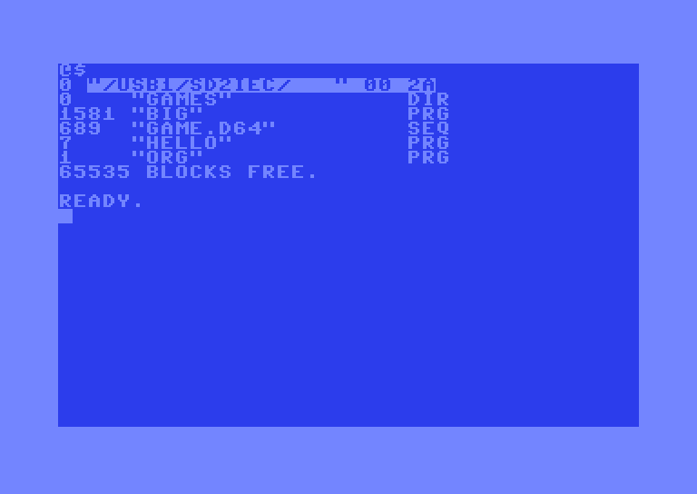
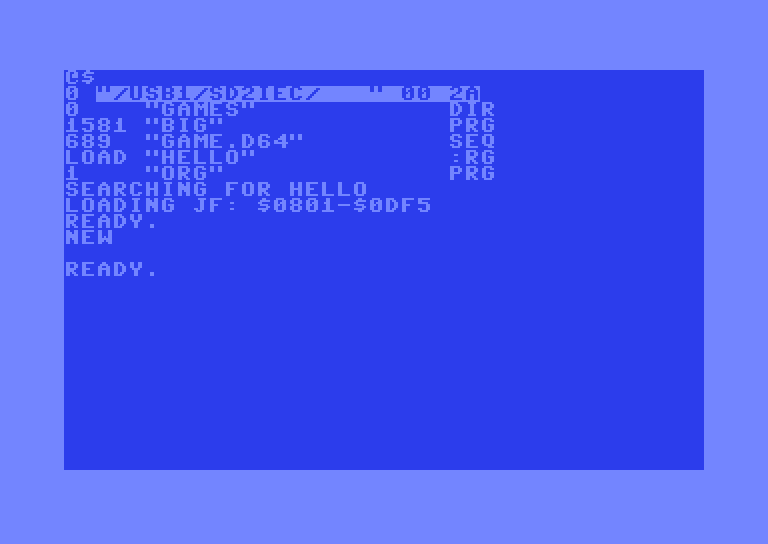
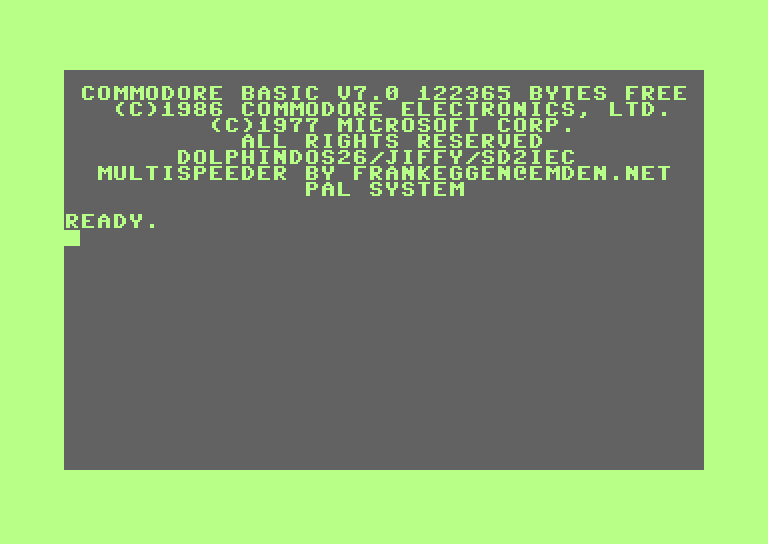

<em>SD2IEC directory, loading from the SD card with JiffyDOS, and the C128 with the DolphinDos26 kernal.</em>

## The parts of the project

### Hardware: Multi-Speeder V3

| Drive | What you get | Repository |
|---|---|---|
| **1541, 1541-II** | 8 DOS banks, 512 KB RAM, PIA parallel port, extra ROM area for DOS extensions; RAMBoard-compatible for nibbler programs | [Switchless-Multi-Speeder-Commodore-1541](https://github.com/FraEgg/Switchless-Multi-Speeder-Commodore-1541) |
| **External 1571** | 8 DOS banks, 512 KB RAM, PIA parallel port; Commodore DOS, DolphinDOS 3, DolphinDos26 and SpeedDos26 in the ready-made template | [Switchless-Multi-Speeder-Commodore-1571](https://github.com/FraEgg/Switchless-Multi-Speeder-Commodore-1571) |
| **C128DCR (internal 1571)** | the same for the built-in drive, plus a kernal switcher that follows the DOS bank | [Switchless-Multi-Speeder-Commodore-C128DCR-1571](https://github.com/FraEgg/Switchless-Multi-Speeder-Commodore-C128DCR-1571) |

Each of the three repositories also holds the browser tool **MS-ROM-Builder** (`rom-builder/MS-ROM-Builder.html`): one tool for all three boards, for assembling your own EPROM images.
| **Parallel cable** | adapter and cable from the drive to the user port of the C64 or C128 | [commodore-1541-parallel-port-adapter](https://github.com/FraEgg/commodore-1541-parallel-port-adapter-c64-c128-speeddos-dolphindos) |

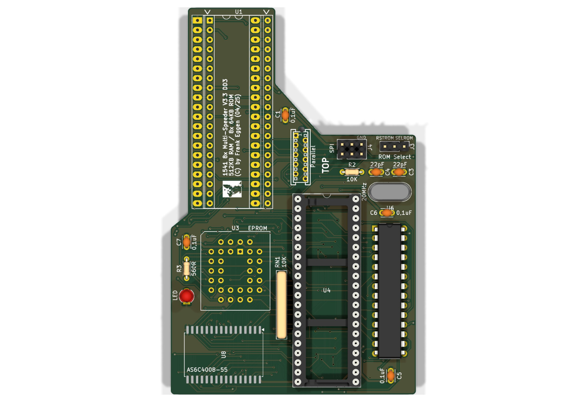
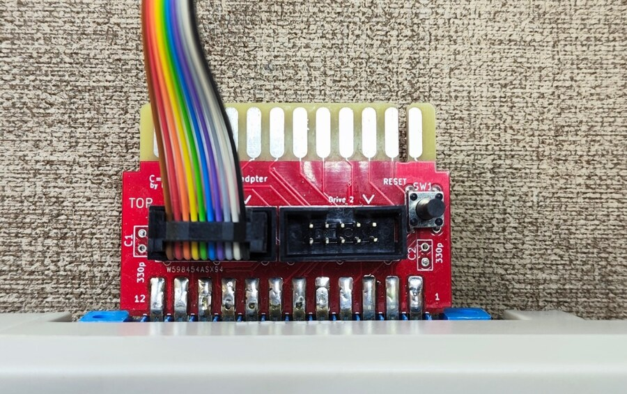

### Firmware: DolphinDos26

A further development of **DolphinDOS 3.0** by Günther Jilg and Jan Bubela, and the firmware that uses the Multi-Speeder to the full:

- whole disks in the drive RAM (`CDR`/`CDW`), RAM disk, track cache, 40 tracks
- drive ROMs for the 1541 Multi-Speeder, for the 1571 (external and C128DCR) and, as DolphinDos26UL, for the Commodore 64 Ultimate and drives with DolphinDOS 2 hardware
- C64 and C128 kernals with DolphinDOS parallel, JiffyDOS and serial
- new: kernals for the **VIC-20 (VC20)**, PAL and NTSC, with DolphinDOS parallel, JiffyDOS and serial
- the **MS-Tools** for testing and copying (see below)

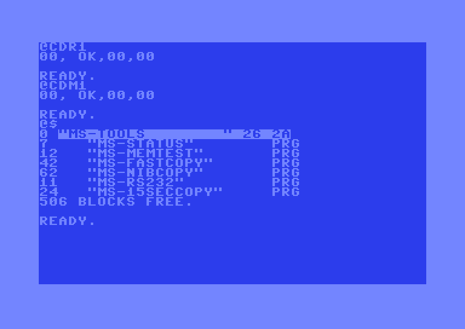

→ [github.com/FraEgg/DolphinDOS](https://github.com/FraEgg/DolphinDOS)

### Firmware: SpeedDos26

A revision of the legendary **SpeedDOS+** by Oliver Eikemeier and Oliver Joppich for the hardware of today:

- runs with the classic SpeedDOS parallel cable on a plain 1541 or 1541-II – even without a Multi-Speeder
- new: firmware for the **1571** with double-sided disks, automatic 2 MHz mode and built-in fast loader, and a kernal for the **C128**
- C64 and C128 kernals with SpeedDOS parallel, JiffyDOS, burst and serial; 40 tracks with `N:NAME,ID+`
- new: kernals for the **VIC-20 (VC20)**, PAL and NTSC, with the SpeedDOS fast loader, JiffyDOS and serial

→ [github.com/FraEgg/SpeedDOS](https://github.com/FraEgg/SpeedDOS)

### Software: MS-Tools

The **MS-Tools** are the toolbox of the project: a set of C64 programs on one disk that put the new hardware to work. They all share one clear menu interface, load like a BASIC program and run on the C64 and in the C64 mode of the C128.

| Tool | What it does for you |
|---|---|
| **MS-FASTCOPY** | Copies a whole disk through the 512 KB RAM of the Multi-Speeder or a REU, with its own fast drive code. 35 or 40 tracks, verify, several copies in a row, directory view. Imports and exports **D64 files** – the direct bridge between real disks and the SD2IEC; on the 1571 also double-sided disks and D71 files. |
| **MS-NIBCOPY** (beta) | A nibble copier after the model of nibtools, running on the real machine: reads and writes tracks bit by bit, including syncs, gaps, tracks 36 to 42, half tracks and weak bits. Imports and exports **G64 files**. |
| **MS-15SECCOPY** | A new version of the classic **15 Seconds Copy** by Mike Pall (1986): copies a disk as raw GCR over the parallel cable and shows every track and sector in a grid. An original 1541 ROM and the original kernal are enough – only a parallel cable and a REU are needed. |
| **MS-MEMTEST** | Tests the 512 KB RAM of the Multi-Speeder bank by bank – the first program to run after building the board. |
| **MS-STATUS** | Shows the error channel of the drive at a keypress. |
| **MS-RS232** | An RS-232 driver in RAM for programs that need the serial interface. |

MS-FASTCOPY also works without a Multi-Speeder: a REU and a parallel connection are enough, for example on the Commodore 64 Ultimate with DolphinDos26UL.

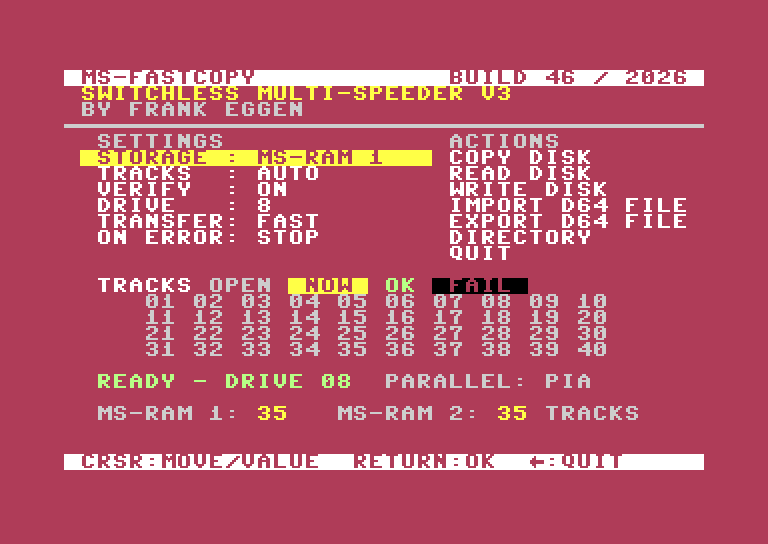
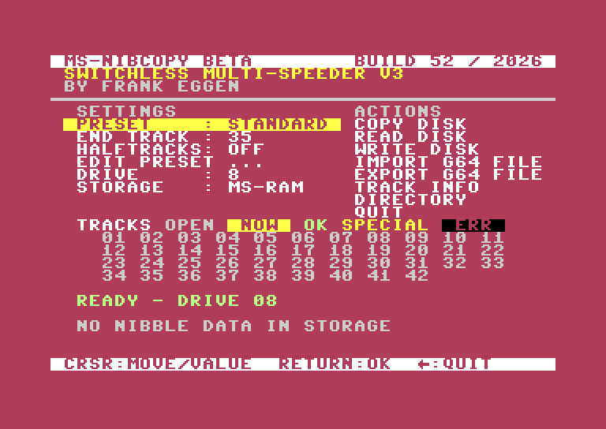
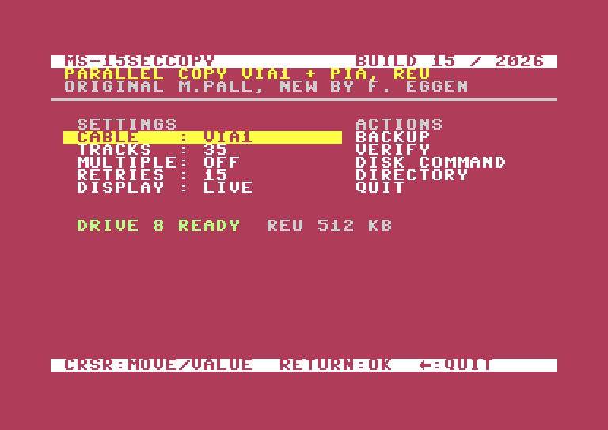
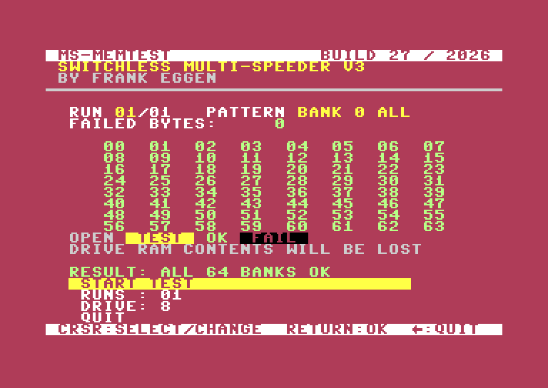

→ Disk image, single programs and the manual: [github.com/FraEgg/DolphinDOS](https://github.com/FraEgg/DolphinDOS)

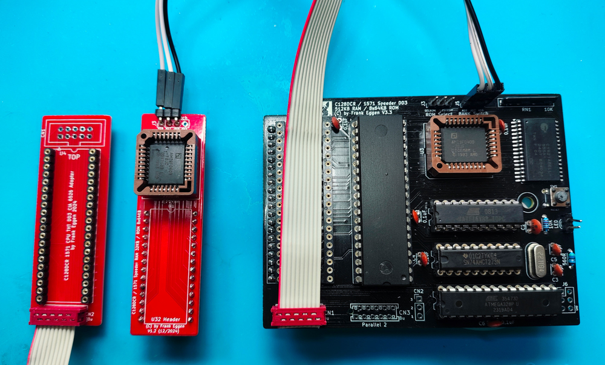

## Where do I start?

| You have | Start here |
|---|---|
| a 1541 or 1541-II and want the full package | [Multi-Speeder V3 for the 1541](https://github.com/FraEgg/Switchless-Multi-Speeder-Commodore-1541), firmware from [DolphinDOS](https://github.com/FraEgg/DolphinDOS) |
| a 1541 with a SpeedDOS parallel cable and no further hardware | [SpeedDOS](https://github.com/FraEgg/SpeedDOS) |
| an external 1571 | [Multi-Speeder V3 for the 1571](https://github.com/FraEgg/Switchless-Multi-Speeder-Commodore-1571) |
| a C128DCR | [Multi-Speeder V3 for the C128DCR](https://github.com/FraEgg/Switchless-Multi-Speeder-Commodore-C128DCR-1571) |
| a Commodore 64 Ultimate | [DolphinDOS](https://github.com/FraEgg/DolphinDOS), manual DolphinDos26UL |
| a C64 or C128 with an SD2IEC and want JiffyDOS plus the function keys | kernal from [DolphinDOS](https://github.com/FraEgg/DolphinDOS) or [SpeedDOS](https://github.com/FraEgg/SpeedDOS) |
| no parallel cable yet | [Parallel port adapter](https://github.com/FraEgg/commodore-1541-parallel-port-adapter-c64-c128-speeddos-dolphindos) |

## JiffyDOS licence: please check

The C64, C128 and VIC-20 kernals of DolphinDos26 and SpeedDos26 contain JiffyDOS transfer routines that are instruction-identical to a JiffyDOS kernal. The JiffyDOS drive firmware is not part of this project; JiffyDOS is commercial software, and a licence is available from [RETRO Innovations](https://www.jiffydos.com). Jim Brain of RETRO Innovations, which holds the JiffyDOS licence rights, confirmed that publishing the kernals on GitHub is fine. As he describes it, the end user would need a licence where the transfer code is the same, as it is here.

**Please check for yourself whether your use calls for an official JiffyDOS licence:** <https://www.jiffydos.com>

Details: [DolphinDOS26 – JiffyDOS licence](https://github.com/FraEgg/DolphinDOS#jiffydos-licence-please-check).

## Credits

| Who | What |
|---|---|
| Günther Jilg, Jan Bubela (Dolphin Software) | DolphinDOS 2.0 and 3.0, the base of DolphinDos26 |
| Oliver Eikemeier, Oliver Joppich; Elektronik Service – Christoph Dichte | SpeedDOS and SpeedDOS+, the base of SpeedDos26 |
| Mark Fellows / Creative Micro Designs; Jim Brain, RETRO Innovations | JiffyDOS |
| Mike Pall | 15 Seconds Copy (1986), the basis of MS-15SECCOPY |
| Pete Rittwage, Markus Brenner | nibtools and MNIB, the model for MS-NIBCOPY |
| Per Bengtsson (RetroNynjah) | [Switchless Multi-ROM](https://github.com/RetroNynjah/Switchless-Multi-ROM-for-27128-27256), the ROM switcher sketch |
| Jim Drew, Joeri van Haren | Help and review of the hardware |
| silverdr | [Technical documentation on DolphinDOS 3](https://e4aws.silverdr.com/projects/dolphindos3/) |
| Stefan Kauf | Support with the idea of the Multi-Speeder |

**Special thanks to Jim Brain of RETRO Innovations** for his support with the JiffyDOS implementation of the kernals.

Multi-Speeder, DolphinDos26, SpeedDos26, the MS-Tools and the manuals: **Frank Eggen**. If you would like to support the project: [donation via PayPal](https://www.paypal.com/donate/?cmd=_s-xclick&hosted_button_id=Q8HXKYARXKT4L&ssrt=1714757590172).

## Licence

Free for private, non-commercial use. No sale and no commercial use (boards, kits, ROM files, programmed EPROMs) without consulting the developer. Private hobby project without any warranty; building and installation at your own risk. Details: [LICENSE.md](LICENSE.md).

---

# Deutsch

## Alte Laufwerke, neue Möglichkeiten

Ein Commodore-Diskettenlaufwerk aus den 1980er-Jahren und ein Kartenleser von heute am selben Rechner, beide mit voller Geschwindigkeit, ohne dazwischen ein ROM zu wechseln: Darum geht es im Multi-Speeder-Projekt.

Der **Switchless 8x Multi-Floppy-Speeder V3** ist eine kleine Platine für den CPU-Sockel des Laufwerks. Er macht aus einer 1541, 1541-II, 1571 oder dem Laufwerk eines C128DCR ein Laufwerk, das **acht DOS-Versionen gleichzeitig** bereithält und **per Befehl** zwischen ihnen umschaltet – ohne Schalter, ohne Loch im Gehäuse, jederzeit rückbaubar. Die Firmware **DolphinDos26** und **SpeedDos26** holt die beiden bekanntesten Parallel-Speeder der 1980er-Jahre in die Gegenwart, und die passenden Kernals lassen den Rechner für jedes Gerät am Bus selbst den schnellsten Übertragungsweg wählen.

## Das Wichtigste

- **Acht DOS-Bänke, per Befehl umgeschaltet.** `@I:8@RNROM`, und das Laufwerk startet mit einem anderen DOS; die LED blinkt die Banknummer. Original-Commodore-DOS, DolphinDOS, SpeedDos26 und DolphinDos26 liegen nebeneinander in einem 512-KB-Flash-EPROM.
- **512 KB RAM im Laufwerk.** DolphinDos26 liest eine ganze Diskette in den Laufwerksspeicher und schreibt sie auf beliebig viele Zieldisketten – ohne dass der Rechner ein einziges Byte bewegt. Derselbe Speicher dient als RAM-Disk und als Track-Cache.
- **Ein echter 8-Bit-Parallelport.** Ein PIA 6821 auf der Platine verbindet das Laufwerk mit dem Userport. 30 KB laden in Sekunden statt in mehr als anderthalb Minuten über den seriellen Bus.
- **Für drei Laufwerksfamilien.** Ein Konzept für 1541 und 1541-II, die externe 1571 und die im C128DCR eingebaute 1571, einschließlich doppelseitiger Disketten und des 2-MHz-Betriebs der 1571.
- **Vollständig dokumentiert.** Bebilderte Handbücher auf Deutsch und Englisch, Schaltpläne, Gerber-Dateien, Stücklisten und fertige EPROM-Vorlagen.

## Ein Kernal, alle Protokolle

Das Herz des Projekts sind die Kernals für den C64 und den C128. Sie kennen nicht mehr nur einen Übertragungsweg. Bei **jedem Zugriff** fragen sie das angesprochene Gerät, was es kann, und nehmen dann den schnellsten Weg:

| Das Gerät am Bus | Der Kernal nutzt | Anzeige beim Laden |
|---|---|---|
| Laufwerk mit DolphinDos26 oder DolphinDOS und Parallelkabel | DolphinDOS parallel | `LOADING DD:` |
| Laufwerk mit SpeedDos26 oder SpeedDOS und Parallelkabel | SpeedDOS parallel | `LOADING SD:` |
| Jedes Gerät mit **JiffyDOS**: SD2IEC, Laufwerke mit JiffyDOS-ROM, Pi1541 | **JiffyDOS** | `LOADING JD:` |
| 1571 oder 1581 am C128 | Burst-Modus von Commodore | `LOADING BU:` (SpeedDos26) |
| Alles andere | seriell wie im Original | – |

Das macht gemischte Anlagen so angenehm. Ein typischer Schreibtisch von heute:

- **Gerät 8:** eine echte 1541 mit Multi-Speeder und Parallelkabel – lädt parallel.
- **Gerät 9:** ein **SD2IEC** mit der ganzen Softwaresammlung auf einer SD-Karte – lädt mit JiffyDOS, und die Funktionstasten wechseln Verzeichnisse und Disk-Images und laden direkt aus dem Directory.
- **Gerät 10:** ein unverändertes Laufwerk eines Freundes – arbeitet seriell wie eh und je.

Alle drei laufen am selben Kernal, gleichzeitig, jedes mit seiner besten Geschwindigkeit. Kein Kernal-Umschalter, kein Kompromiss. Die Kernals sind auch mit **S-JiffyDOS 1541** getestet.

<em>Derselbe Rechner, drei Geräte, drei Protokolle: DolphinDOS parallel, SpeedDOS parallel und JiffyDOS – automatisch gewählt.</em>

## Retro-Hardware trifft neue Hardware

Das Projekt schlägt bewusst Brücken zwischen den Originalgeräten und der Hardware von heute:

- **SD2IEC.** JiffyDOS im Kernal und eigene Funktionstasten machen den Kartenleser zum vollwertigen Partner des echten Laufwerks. Mit den MS-Tools kopierst du von Diskette auf SD-Karte und zurück.
- **FPGA-basierte Geräte wie der Commodore 64 Ultimate.** **DolphinDos26UL** ist eine Firmware eigens für das Laufwerk des Ultimate: Sie nutzt das Parallelkabel, das das Gerät intern bereitstellt. Kernal DolphinDos26 und Laufwerks-ROM im Menü laden, und der Ultimate lädt parallel – ganz ohne Löten.
- **Pi1541 und JiffyDOS-Laufwerke.** Geräte mit einem JiffyDOS-Laufwerks-ROM werden automatisch mit JiffyDOS bedient; ein eigenes JiffyDOS-Handbuch erklärt Befehle, Funktionstasten und Einrichtung.
- **C128 und C128DCR.** Die C128-Kernals bringen alles in den C128-Modus. Im C128DCR schaltet ein Kernal-Switcher den Kernal zusammen mit der DOS-Bank des Laufwerks um: ein Befehl, und Rechner und Laufwerk sprechen dieselbe Sprache.
- **G64-Disk-Images.** MS-NIBCOPY (Beta) liest Disketten bitgenau und tauscht sie als G64-Dateien mit Emulatoren, dem SD2IEC und dem Ultimate aus.

<em>Directory des SD2IEC, Laden von der SD-Karte mit JiffyDOS und der C128 mit dem DolphinDos26-Kernal.</em>

## Die Teile des Projekts

### Hardware: Multi-Speeder V3

| Laufwerk | Das bekommst du | Repository |
|---|---|---|
| **1541, 1541-II** | 8 DOS-Bänke, 512 KB RAM, PIA-Parallelport, zusätzlicher ROM-Bereich für DOS-Erweiterungen; RAMBoard-kompatibel für Nibbler-Programme | [Switchless-Multi-Speeder-Commodore-1541](https://github.com/FraEgg/Switchless-Multi-Speeder-Commodore-1541) |
| **Externe 1571** | 8 DOS-Bänke, 512 KB RAM, PIA-Parallelport; Commodore-DOS, DolphinDOS 3, DolphinDos26 und SpeedDos26 in der fertigen Vorlage | [Switchless-Multi-Speeder-Commodore-1571](https://github.com/FraEgg/Switchless-Multi-Speeder-Commodore-1571) |
| **C128DCR (internes Laufwerk 1571)** | dasselbe für das eingebaute Laufwerk, dazu ein Kernal-Switcher, der der DOS-Bank folgt | [Switchless-Multi-Speeder-Commodore-C128DCR-1571](https://github.com/FraEgg/Switchless-Multi-Speeder-Commodore-C128DCR-1571) |

In jedem der drei Repositorys liegt außerdem das Browser-Werkzeug **MS-ROM-Builder** (`rom-builder/MS-ROM-Builder.html`): ein Werkzeug für alle drei Platinen, mit dem sich eigene EPROM-Images zusammenstellen lassen.
| **Parallelkabel** | Adapter und Kabel vom Laufwerk zum Userport von C64 oder C128 | [commodore-1541-parallel-port-adapter](https://github.com/FraEgg/commodore-1541-parallel-port-adapter-c64-c128-speeddos-dolphindos) |

### Firmware: DolphinDos26

Eine Weiterentwicklung von **DolphinDOS 3.0** von Günther Jilg und Jan Bubela – und die Firmware, die den Multi-Speeder voll ausnutzt:

- ganze Disketten im Laufwerks-RAM (`CDR`/`CDW`), RAM-Disk, Track-Cache, 40 Spuren
- Laufwerks-ROMs für den 1541 Multi-Speeder, für die 1571 (extern und C128DCR) und als DolphinDos26UL für den Commodore 64 Ultimate und Laufwerke mit DolphinDOS-2-Hardware
- C64- und C128-Kernals mit DolphinDOS parallel, JiffyDOS und seriell
- neu: Kernals für den **VIC-20 (VC20)**, PAL und NTSC, mit DolphinDOS parallel, JiffyDOS und seriell
- die **MS-Tools** zum Testen und Kopieren (siehe unten)

→ [github.com/FraEgg/DolphinDOS](https://github.com/FraEgg/DolphinDOS)

### Firmware: SpeedDos26

Eine Überarbeitung des legendären **SpeedDOS+** von Oliver Eikemeier und Oliver Joppich für die Hardware von heute:

- läuft mit dem klassischen SpeedDOS-Parallelkabel an einer einfachen 1541 oder 1541-II – auch ohne Multi-Speeder
- neu: Firmware für die **1571** mit doppelseitigen Disketten, automatischem 2-MHz-Betrieb und eingebautem Schnelllader sowie ein Kernal für den **C128**
- C64- und C128-Kernals mit SpeedDOS parallel, JiffyDOS, Burst und seriell; 40 Spuren mit `N:NAME,ID+`
- neu: Kernals für den **VIC-20 (VC20)**, PAL und NTSC, mit dem SpeedDOS-Schnelllader, JiffyDOS und seriell

→ [github.com/FraEgg/SpeedDOS](https://github.com/FraEgg/SpeedDOS)

### Software: MS-Tools

Die **MS-Tools** sind der Werkzeugkasten des Projekts: eine Sammlung von C64-Programmen auf einer Diskette, die die neue Hardware in Arbeit setzen. Alle haben dieselbe übersichtliche Menüoberfläche, laden wie ein BASIC-Programm und laufen am C64 und im C64-Modus des C128.

| Tool | Das bringt es dir |
|---|---|
| **MS-FASTCOPY** | Kopiert eine ganze Diskette über das 512-KB-RAM des Multi-Speeders oder eine REU, mit eigenem schnellen Laufwerkscode. 35 oder 40 Spuren, Verify, mehrere Kopien nacheinander, Directory-Anzeige. Importiert und exportiert **D64-Dateien** – die direkte Brücke zwischen echten Disketten und dem SD2IEC; an der 1571 auch doppelseitige Disketten und D71-Dateien. |
| **MS-NIBCOPY** (Beta) | Ein Nibble-Kopierer nach dem Vorbild der nibtools, direkt am echten Rechner: liest und schreibt Spuren bitgenau, einschließlich Syncs, Lücken, Spur 36 bis 42, Halbspuren und Weak Bits. Importiert und exportiert **G64-Dateien**. |
| **MS-15SECCOPY** | Eine neue Fassung des Klassikers **15 Seconds Copy** von Mike Pall (1986): kopiert eine Diskette als rohes GCR über das Parallelkabel und zeigt jede Spur und jeden Sektor in einem Raster. Original-1541-ROM und Original-Kernal genügen – nötig sind nur ein Parallelkabel und eine REU. |
| **MS-MEMTEST** | Prüft die 512 KB RAM des Multi-Speeders Bank für Bank – das erste Programm nach dem Aufbau der Platine. |
| **MS-STATUS** | Zeigt den Fehlerkanal des Laufwerks auf Tastendruck. |
| **MS-RS232** | Ein RS-232-Treiber im RAM für Programme, die die serielle Schnittstelle brauchen. |

MS-FASTCOPY geht auch ohne Multi-Speeder: Eine REU und eine Parallelverbindung genügen, zum Beispiel am Commodore 64 Ultimate mit DolphinDos26UL.

→ Disketten-Abbild, einzelne Programme und das Handbuch: [github.com/FraEgg/DolphinDOS](https://github.com/FraEgg/DolphinDOS)

## Wo fange ich an?

| Du hast | Hier geht es los |
|---|---|
| eine 1541 oder 1541-II und willst das volle Paket | [Multi-Speeder V3 für die 1541](https://github.com/FraEgg/Switchless-Multi-Speeder-Commodore-1541), Firmware aus [DolphinDOS](https://github.com/FraEgg/DolphinDOS) |
| eine 1541 mit SpeedDOS-Parallelkabel und sonst keine Hardware | [SpeedDOS](https://github.com/FraEgg/SpeedDOS) |
| eine externe 1571 | [Multi-Speeder V3 für die 1571](https://github.com/FraEgg/Switchless-Multi-Speeder-Commodore-1571) |
| einen C128DCR | [Multi-Speeder V3 für den C128DCR](https://github.com/FraEgg/Switchless-Multi-Speeder-Commodore-C128DCR-1571) |
| einen Commodore 64 Ultimate | [DolphinDOS](https://github.com/FraEgg/DolphinDOS), Handbuch DolphinDos26UL |
| einen C64 oder C128 mit SD2IEC und willst JiffyDOS samt Funktionstasten | Kernal aus [DolphinDOS](https://github.com/FraEgg/DolphinDOS) oder [SpeedDOS](https://github.com/FraEgg/SpeedDOS) |
| noch kein Parallelkabel | [Parallelport-Adapter](https://github.com/FraEgg/commodore-1541-parallel-port-adapter-c64-c128-speeddos-dolphindos) |

## JiffyDOS-Lizenz: bitte prüfen

Die C64-, C128- und VIC-20-Kernals von DolphinDos26 und SpeedDos26 enthalten JiffyDOS-Übertragungsroutinen, die befehlsgleich aus einem JiffyDOS-Kernal stammen. Die JiffyDOS-Firmware für das Laufwerk gehört nicht zu diesem Projekt; JiffyDOS ist kommerzielle Software, eine Lizenz gibt es bei [RETRO Innovations](https://www.jiffydos.com). Jim Brain von RETRO Innovations, das die JiffyDOS-Lizenzrechte hält, hat die Veröffentlichung der Kernals auf GitHub erlaubt. Nach seiner Beschreibung bräuchte der Endanwender eine Lizenz, wenn der Übertragungscode derselbe ist – so wie hier.

**Bitte prüfe selbst, ob du wegen der Nutzung eine offizielle JiffyDOS-Lizenz erwerben solltest:** <https://www.jiffydos.com>

Einzelheiten: [DolphinDOS26 – JiffyDOS-Lizenz](https://github.com/FraEgg/DolphinDOS#jiffydos-lizenz-bitte-prüfen).

## Dank

| Wer | Was |
|---|---|
| Günther Jilg, Jan Bubela (Dolphin Software) | DolphinDOS 2.0 und 3.0, die Grundlage von DolphinDos26 |
| Oliver Eikemeier, Oliver Joppich; Elektronik Service – Christoph Dichte | SpeedDOS und SpeedDOS+, die Grundlage von SpeedDos26 |
| Mark Fellows / Creative Micro Designs; Jim Brain, RETRO Innovations | JiffyDOS |
| Mike Pall | 15 Seconds Copy (1986), die Grundlage von MS-15SECCOPY |
| Pete Rittwage, Markus Brenner | nibtools und MNIB, das Vorbild für MS-NIBCOPY |
| Per Bengtsson (RetroNynjah) | [Switchless Multi-ROM](https://github.com/RetroNynjah/Switchless-Multi-ROM-for-27128-27256), der Sketch des ROM-Umschalters |
| Jim Drew, Joeri van Haren | Hilfe und Durchsicht der Hardware |
| silverdr | [Technische Dokumentation zu DolphinDOS 3](https://e4aws.silverdr.com/projects/dolphindos3/) |
| Stefan Kauf | Unterstützung bei der Idee des Multi-Speeders |

**Besonderer Dank an Jim Brain von RETRO Innovations** für seine Unterstützung bei der JiffyDOS-Implementierung der Kernals.

Multi-Speeder, DolphinDos26, SpeedDos26, die MS-Tools und die Handbücher: **Frank Eggen**. Wer das Projekt unterstützen möchte: [Spende über PayPal](https://www.paypal.com/donate/?cmd=_s-xclick&hosted_button_id=Q8HXKYARXKT4L&ssrt=1714757590172).

## Lizenz

Frei für den privaten, nicht kommerziellen Gebrauch. Kein Verkauf und keine kommerzielle Nutzung (Platinen, Bausätze, ROM-Dateien, gebrannte EPROMs) ohne Rücksprache mit dem Entwickler. Privates Hobbyprojekt ohne jede Gewährleistung; Nachbau und Einbau auf eigene Gefahr. Einzelheiten: [LICENSE.md](LICENSE.md).
